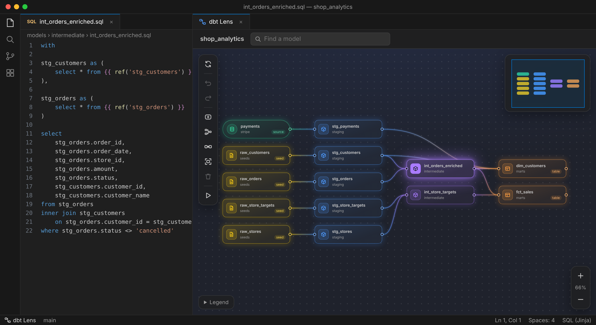
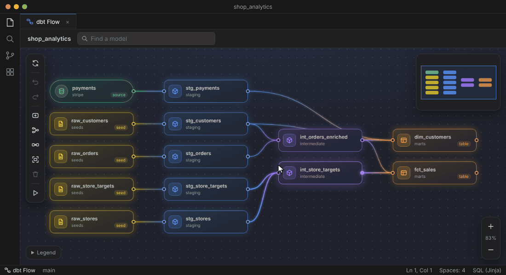
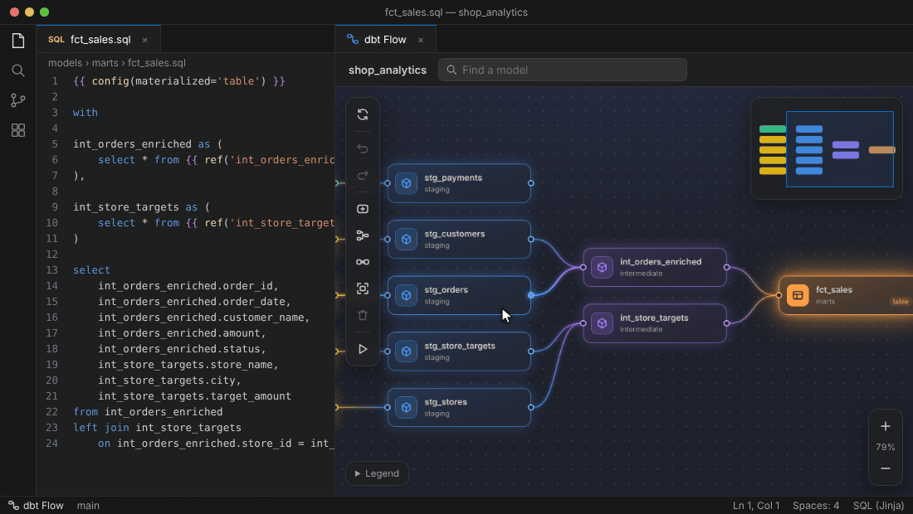
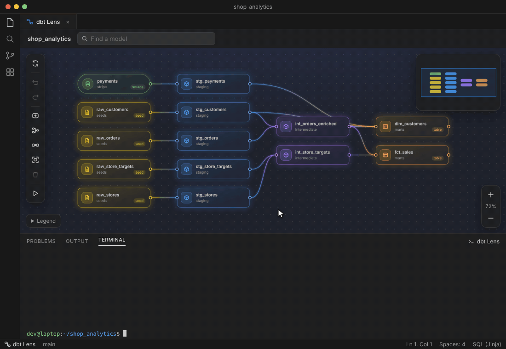
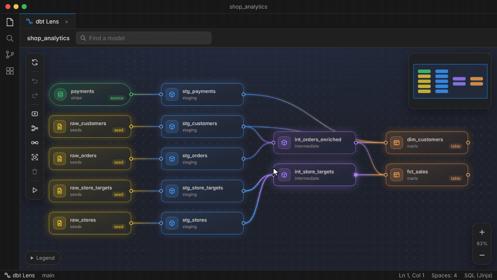

# dbt Lens

**Your dbt project as a living flowchart, right next to your SQL.**

dbt Lens is a VS Code extension that draws every model, seed and source in your dbt project on a canvas. Click around to see lineage, sketch new models as boxes that become `.sql` files, run dbt on any box, and find out exactly where a column disappears.



The canvas needs no dbt run: it reads `ref()` and `source()` straight from your files and updates every time you save.

---

## See how everything connects

Click any box to light up everything it depends on and everything that depends on it. The box for the file you have open always glows, so you never lose your place.



## Sketch a model, get the file

Right-click the canvas to add a box, drag from one box to another to connect them, and choose **Create file**. dbt Lens writes the `.sql` file with one import CTE per upstream model, ready for you to fill in.



Dragging a connection onto a model that already has a file adds the `ref()` to the top of that file. You are asked first.

## Run dbt from the canvas

Right-click a box and choose **dbt build**, **run**, **test** or **compile**: it runs that model and everything upstream of it (`--select +model`), just as you would type it. The **▶** button in the tool bar runs a command on the whole project, including `seed`, `snapshot`, `docs generate`, `deps` and `debug`.



Commands go to a normal VS Code terminal called *dbt Lens*, so you see dbt's own output and can stop it with Ctrl+C. Unsaved files are saved first.

## Find where a column disappears

Right-click a box, choose **Trace column…** and pick a column. dbt Lens shows which models still have it, and marks with ✕ the exact connection where it is dropped.



Column tracing uses [DAGtracer](#column-tracing-with-dagtracer) (`dgt`), an optional companion tool.

## And the things you would expect

- **Rename without breaking refs.** Rename a model on the canvas or in Explorer, and dbt Lens offers to update every `ref()` to it.
- **Nothing is deleted by accident.** Removing a box only takes it off the canvas; your files stay. *Show removed boxes* brings them back.
- **Undo everything.** Ctrl+Z undoes moves, new boxes, connections and file edits. If you changed a file by hand since, it stops and tells you instead of overwriting your work.
- **Broken refs stand out.** A `ref()` to a model that does not exist shows as a red box, with quick fixes on its menu.
- **Your layout, your way.** Drag boxes anywhere, tidy up with one click, and switch between left-to-right and top-to-bottom flow.
- **Colours by folder.** `staging`, `intermediate` and `marts` get their usual colours; any other folder gets its own.

---

## Getting started

dbt Lens is not on the VS Code Marketplace yet. To try it:

1. Clone this repository and open it in VS Code.
2. Press **F5** (or *Run → Start Debugging*). A new VS Code window opens with dbt Lens loaded.
3. In that window, open a folder that contains a `dbt_project.yml`. The canvas opens by itself to the right of your code.

If you close the canvas, bring it back with the **dbt Lens** button in the status bar, the canvas button in the title bar of any `.sql` file, or *dbt Lens: Open Canvas* in the command palette.

### Running dbt

dbt Lens types the command into a terminal in your project folder, so it uses whatever `dbt` that terminal finds. If dbt lives in a virtual environment, or you use a different target, tell dbt Lens in your settings:

```jsonc
{
  "dbtFlow.dbt.executable": "~/.venvs/dbt/bin/dbt",  // the dbt to run
  "dbtFlow.dbt.target": "prod",                       // added as --target
  "dbtFlow.dbt.envFile": "~/.dbt.env"                 // KEY=VALUE lines, e.g. credentials
}
```

### Column tracing with DAGtracer

*Trace column…* appears when [DAGtracer](https://github.com/alexD1990/DAGtracer)'s `dgt` command is installed. It reads dbt's `target/manifest.json` and `target/catalog.json`, so run **▶ → dbt docs generate** first. If `dgt` is not on your `PATH`, set `dbtFlow.integrations.dagtracer.executable` to its full path. *dbt Lens: Check Integrations* shows whether it was found.

---

## Reference

<details>
<summary><b>Keyboard and mouse</b></summary>

| Key | Action |
| --- | --- |
| Right-click | Menu for the box, connection or canvas under the pointer |
| Drag the right-hand dot onto a box | Connect |
| Click a box | Highlight lineage |
| Double-click a box | Open its file (or rename a box without a file) |
| Ctrl+Z / Ctrl+Shift+Z | Undo / redo |
| Delete | Delete a box without a file, or take any other box off the canvas (files are kept) |
| F | Fit to view |
| Ctrl+F, Enter | Find a model and jump to it |
| Esc | Clear a column trace or lineage highlight |
| Scroll / drag the background | Zoom / pan |

</details>

<details>
<summary><b>Settings</b></summary>

| Setting | Default | |
| --- | --- | --- |
| `dbtFlow.openOnStartup` | `true` | Open the canvas next to your code when a dbt project opens. |
| `dbtFlow.projectPath` | empty | Folder holding `dbt_project.yml`. Empty means find it automatically. |
| `dbtFlow.confirmFileEdits` | `true` | Ask before adding or changing a `ref()` in an existing file. |
| `dbtFlow.openCreatedFile` | `true` | Open the new file after *Create file*. |
| `dbtFlow.dbt.executable` | `dbt` | The dbt command, or its full path. |
| `dbtFlow.dbt.target` | empty | Added as `--target` to every dbt command. Empty uses the profile's default. |
| `dbtFlow.dbt.envFile` | empty | A file of `KEY=VALUE` or `export` lines loaded once into the dbt Lens terminal. |
| `dbtFlow.integrations.dagtracer.enabled` | `true` | Offer column tracing when `dgt` is installed. |
| `dbtFlow.integrations.dagtracer.executable` | `dgt` | The `dgt` command, or its full path. |
| `dbtFlow.integrations.dagtracer.timeoutSeconds` | `120` | Stop a trace that takes longer than this. |

</details>

<details>
<summary><b>What a new file looks like</b></summary>

*Create file* writes one import CTE per upstream box, so the refs are in place and the rest is yours:

```sql
with

stg_customers as (
    select * from {{ ref('stg_customers') }}
),

int_orders_enriched as (
    select * from {{ ref('int_orders_enriched') }}
)

select * from stg_customers
```

New boxes go in the folder suggested by their name (`stg_` → staging, `int_` → intermediate, `fct_`/`dim_` → marts), and you can pick another.

</details>

<details>
<summary><b>The <code>.dbtflow.json</code> file</b></summary>

Box positions, boxes without files, their connections, the flow direction and the boxes you took off the canvas are kept in `.dbtflow.json` next to `dbt_project.yml`. Commit it if your team should see the same layout and sketches, or add it to `.gitignore` if not. It is only written after you change something on the canvas.

</details>

<details>
<summary><b>How the project is read</b></summary>

dbt Lens finds `dbt_project.yml` (up to three folders deep), reads `model-paths`, `seed-paths` and `snapshot-paths`, and draws every model from its `ref()` and `source()` calls. Seeds, snapshots and Python models are included. It does not run dbt or read `target/` to draw the canvas, so it works on a fresh clone and on models that do not compile yet. Use **Sync with files** (the top button in the tool bar) to read everything again and lay it out from scratch; Ctrl+Z puts your old layout back.

</details>

## Development

Plain JavaScript with no build step and no dependencies.

```bash
npm test      # model, extension, dbt and integration tests (node --test)
```

`src/` holds the logic (parsing, layout, SQL edits, undo, dbt commands) with no VS Code imports, so it is tested directly. `extension.js` wires it to VS Code, and `media/` is the canvas. Optional tools such as DAGtracer plug in under `src/integrations/`.

The pictures in this README are recorded from the real canvas with `node scripts/readme-media/record.js` (needs Playwright with Chromium, and ffmpeg).
